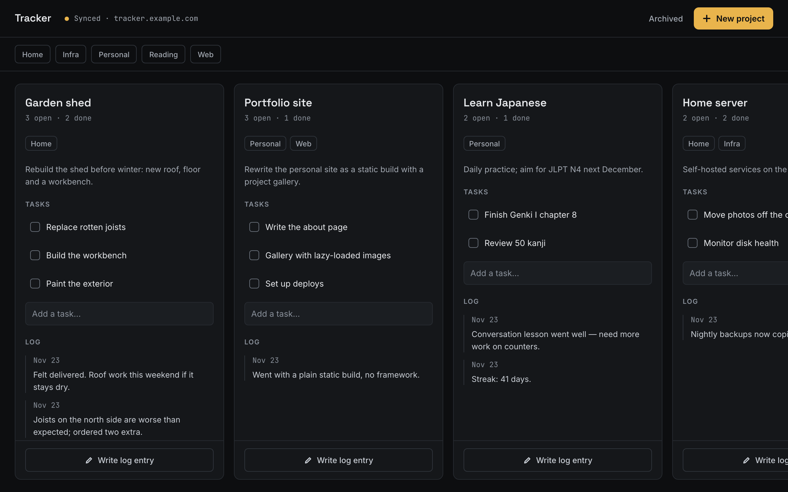
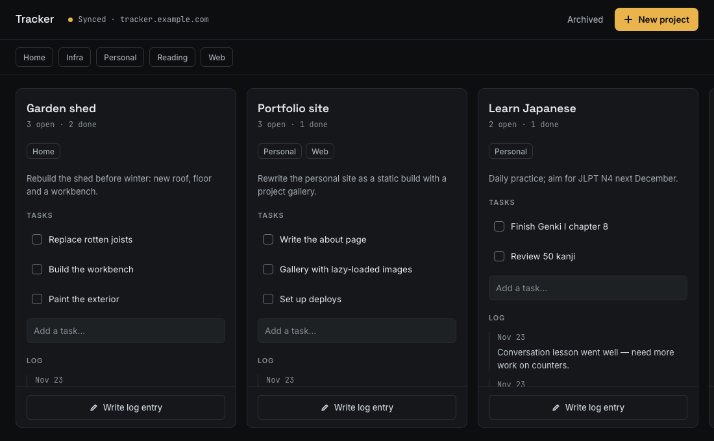
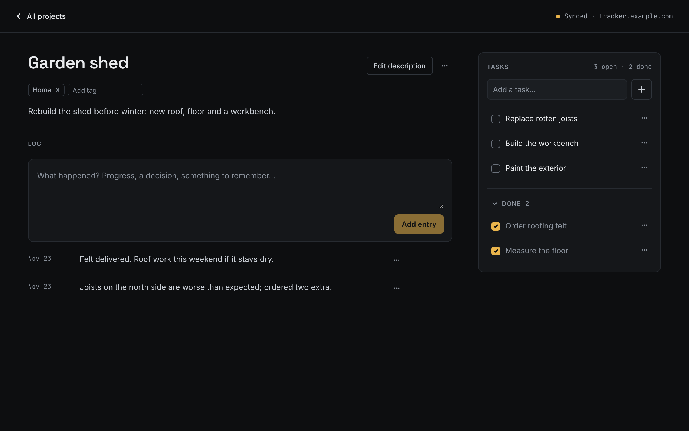
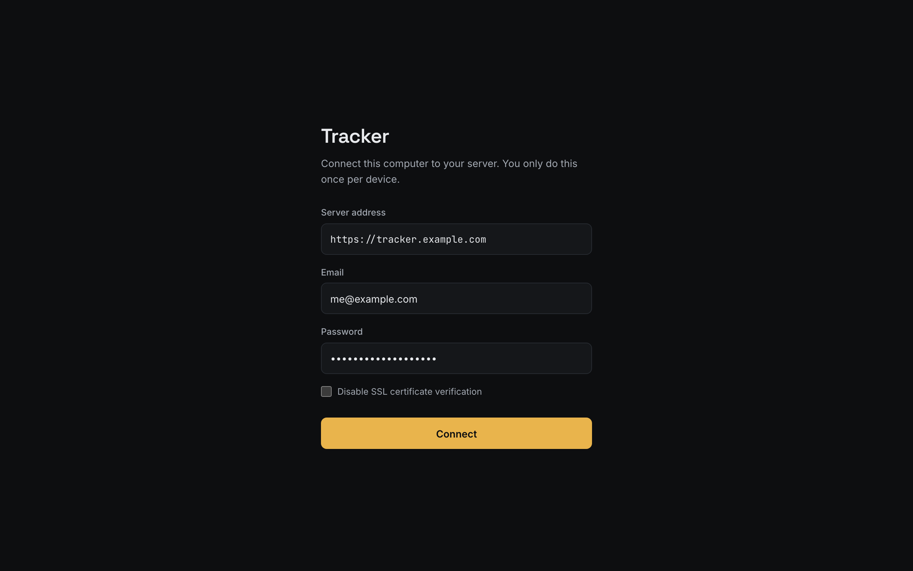
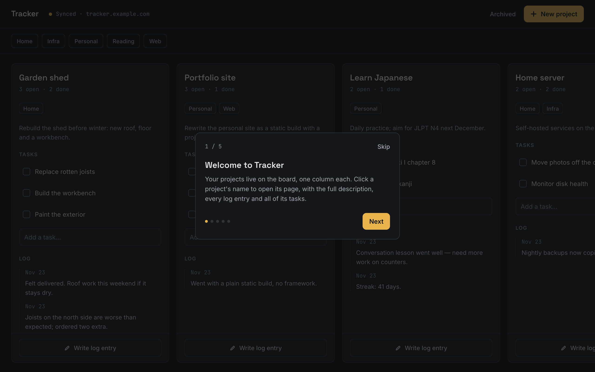

<p align="center">
  
</p>

<h1 align="center">Tracker</h1>

<p align="center">
  <a href="https://github.com/Hazeman99/tracker/actions/workflows/ci.yml"></a>
  <a href="https://github.com/Hazeman99/tracker/releases"></a>
  <a href="LICENSE"></a>
</p>

<p align="center">
  
</p>

A minimal, self-hosted, single-user project tracker: a small Go API you run
on your own server, and a native desktop app for macOS and Linux.

- **`api/`** — Go API (standard library router, SQLite in WAL mode), shipped
  as a static binary and a distroless Docker image.
- **`desktop/`** — Wails v3 desktop app (React + TypeScript + Vite frontend)
  for macOS (Apple Silicon) and Linux. All network calls are made from Go;
  the session token lives in the OS keychain.
- **`deploy/`** — Docker Compose (API + Caddy) with automatic HTTPS.

## Features

- Projects with tasks, freeform log entries and tags; drag-to-reorder.
- Single-user by design: no sharing, no admin UI, no telemetry.
- Your data is one SQLite file on your server; backup is a `tar` away.
- Security first: Argon2id passwords, hashed session tokens, strict
  per-user data isolation, rate limiting and login lockout. The full
  threat model and OWASP API Top 10 review live in [SECURITY.md](SECURITY.md).

## Screenshots

Check off a task and it stays on the board for a few seconds, then moves to
the project's **Done** list:

<p align="center">
  
</p>

| Project page | Connect screen | First-run tour |
| --- | --- | --- |
| [](docs/images/project.png) | [](docs/images/connect.png) | [](docs/images/onboarding.png) |

## Install the desktop app

Download the latest build from the
[releases page](https://github.com/Hazeman99/tracker/releases):

- **macOS (Apple Silicon)** — unzip `tracker_*_macos_arm64.app.zip` and move
  `tracker.app` to `/Applications`. The app is ad-hoc signed, not notarized,
  so the first launch is blocked with "Apple could not verify…". Click
  **Done** (not Move to Trash), then go to **System Settings → Privacy &
  Security**, scroll to the Security section and click **Open Anyway**.
  This is needed once per update. Equivalent terminal one-liner:
  `xattr -d com.apple.quarantine /Applications/tracker.app`.
- **Linux** — install the `.deb` (Debian 13+/Ubuntu 24.04+) or `.rpm`
  (Fedora) for your architecture, or use the bare binary from the `.tar.gz`.
  The app needs GTK 4.10+, WebKitGTK 6.0 and a running Secret Service
  (GNOME Keyring, KWallet ≥ 5.97, KeePassXC…) — it stores the session in the
  keychain and refuses to sign in without one.

  On Ubuntu 23.10+ the kernel blocks the unprivileged user namespaces that
  WebKitGTK's sandbox needs (the symptom is a crash at launch with
  `bwrap: setting up uid map: Permission denied`). The `.deb`/`.rpm`
  packages install and load an AppArmor profile
  (`/etc/apparmor.d/tracker`) that grants it. If you use the bare binary
  instead, copy
  [`desktop/build/linux/apparmor/tracker`](desktop/build/linux/apparmor/tracker)
  to `/etc/apparmor.d/tracker`, adjust the binary path inside it to where
  you put `tracker`, and run `sudo apparmor_parser -r /etc/apparmor.d/tracker`.

On first run, enter your server address (e.g. `https://tracker.example.com`),
email and password on the Connect screen. If your server uses a self-signed
certificate, tick **Disable SSL certificate verification** — only do this for
a server you trust, since it also disables protection against
man-in-the-middle attacks. Each device appears under **Signed-in devices** in
the settings popover (click the sync indicator), where it can be revoked.

## Self-host the server

Requirements: a Linux server with Docker Engine 28+ and the Compose plugin
(`curl -fsSL https://get.docker.com | sh`, or
https://docs.docker.com/engine/install/).

1. **Get the code.**

   ```sh
   git clone https://github.com/Hazeman99/tracker.git && cd tracker/deploy
   ```

2. **Configure.**

   ```sh
   cp .env.example .env
   # edit .env: TRACKER_DOMAIN (the server's DNS name) and TRACKER_TLS
   ```

   `TRACKER_TLS` picks how Caddy gets its certificate:

   - *An e-mail address* — automatic Let's Encrypt certificates. The domain
     must resolve to this server, and ports 80 and 443 must be reachable
     from the internet.
   - *`internal`* — Caddy issues a self-signed certificate (for LAN-only
     servers without a public domain). Either trust Caddy's root CA on your
     devices, or enable **Disable SSL certificate verification** when
     connecting the desktop app.

   `TRACKER_BIND_IP` (default: all interfaces) and `TRACKER_HTTPS_PORT`
   (default: 443) narrow where the server listens.

3. **Start.**

   ```sh
   sudo docker compose up -d --build
   curl https://tracker.example.com/v1/healthz   # → {"status":"ok"}
   ```

4. **Create your user.** There is no registration endpoint; the password is
   read from the terminal without echo (minimum 12 characters):

   ```sh
   sudo docker compose exec -it api /tracker-api user create --email you@example.com
   ```

Prebuilt API artifacts are also published with every release: static Linux
binaries (amd64/arm64) on the releases page and a multi-arch Docker image at
`ghcr.io/hazeman99/tracker-api`.

Other admin commands (run from `deploy/`):

```sh
# Set a new password; signs out every device.
docker compose exec -it api /tracker-api user reset-password --email you@example.com
# Revoke every session of every user (asks for confirmation).
docker compose exec -it api /tracker-api sessions revoke-all
```

**Updating:** `git pull && sudo docker compose up -d --build` in `deploy/`.
Migrations run automatically at start-up.

### Backing up and restoring the database

The database is the file `tracker.db` (plus its `-wal`/`-shm` companions) in
the Docker volume `tracker_tracker-data`. It contains password and token
*hashes*; store backups somewhere private.

**Backup** (stops the API for a second so the copy is consistent):

```sh
cd deploy
docker compose stop api
docker run --rm -v tracker_tracker-data:/data:ro -v "$PWD":/backup alpine \
  tar czf /backup/tracker-$(date +%F).tar.gz -C /data .
docker compose start api
```

**Restore:**

```sh
cd deploy
docker compose stop api
docker run --rm -v tracker_tracker-data:/data -v "$PWD":/backup alpine \
  sh -c 'rm -f /data/tracker.db /data/tracker.db-wal /data/tracker.db-shm &&
         tar xzf /backup/tracker-YYYY-MM-DD.tar.gz -C /data &&
         chown -R 65532:65532 /data && chmod 700 /data && chmod 600 /data/tracker.db*'
docker compose start api
```

Automate the backup with cron (e.g. nightly) and copy the archives off the
server.

## Building from source

Common prerequisites: **Go 1.27** (the `toolchain` line in `go.mod` downloads
it automatically if you have an older Go), **Node.js 20+** with npm, and the
Wails CLI:

```sh
go install github.com/wailsapp/wails/v3/cmd/wails3@v3.1.0
export PATH="$(go env GOPATH)/bin:$PATH"
```

### macOS (Apple Silicon)

1. Install the Xcode command line tools: `xcode-select --install`.
2. From the repository root:

   ```sh
   make desktop-build
   ```

3. The app is `desktop/bin/tracker.app`.

### Linux

1. Install the build dependencies (GTK 4.10+ and WebKitGTK 6; Debian 12's
   GTK 4.8 is too old):

   - Debian 13+/Ubuntu 24.04+: `sudo apt install build-essential pkg-config libgtk-4-dev libwebkitgtk-6.0-dev`
   - Fedora: `sudo dnf install gcc pkgconf-pkg-config gtk4-devel webkitgtk6.0-devel`

2. From the repository root:

   ```sh
   make desktop-build
   ```

3. The binary is `desktop/bin/tracker`. To produce a `.deb` or `.rpm`
   instead, run `cd desktop && wails3 task linux:create:deb` (or
   `linux:create:rpm`).

### API

`make api-build` produces a static binary in `api/bin/`, and
`docker build api/` builds the distroless image.

## Development

```sh
# Terminal 1 — API on http://127.0.0.1:8080 with api/dev.db
make api-run

# Create a local user (in another terminal)
cd api && TRACKER_DB_PATH=./dev.db go run ./cmd/tracker-api user create --email me@example.com

# Terminal 2 — desktop app with hot reload. Dev builds (build tag `dev`)
# also accept http://localhost / http://127.0.0.1 server addresses.
make desktop-dev
```

Then connect the app to `http://127.0.0.1:8080`.

Checks (CI runs these on every push and pull request):

```sh
make check                         # vet, race tests, govulncheck, gosec, frontend type check
make check VULNCHECK_IN_DOCKER=1   # if vuln.go.dev is blocked on your network
```

Other targets: `make api-build` (static API binary in `api/bin/`),
`make desktop-frontend` (generate bindings and build the frontend only).

### Configuration reference (API)

| Variable | Default | Meaning |
| --- | --- | --- |
| `TRACKER_LISTEN_ADDR` | `:8080` | Listen address |
| `TRACKER_DB_PATH` | `/data/tracker.db` | SQLite database file |
| `TRACKER_TRUSTED_PROXY` | *(none)* | IP of the reverse proxy allowed to set `X-Forwarded-For` (set to Caddy's fixed address by `deploy/compose.yaml`) |
| `TRACKER_DOMAIN` | — | Compose/Caddy only: the server's DNS name |
| `TRACKER_TLS` | `internal` | Compose/Caddy only: ACME e-mail address (Let's Encrypt) or `internal` (self-signed) |
| `TRACKER_BIND_IP` | `0.0.0.0` | Compose only: the address ports are published on |
| `TRACKER_HTTPS_PORT` | `443` | Compose/Caddy only: HTTPS port |

### Repository layout

```
api/
  cmd/tracker-api/       entry point (serve + admin CLI)
  internal/auth          Argon2id, tokens, ids
  internal/db            SQLite open + embedded migrations
  internal/store         data access (every query scoped by user)
  internal/server        HTTP handlers, middleware, tests
  internal/ratelimit     token buckets, login lockout
deploy/                  compose.yaml, Caddyfile, .env.example
desktop/
  main.go                Wails app, CSP headers
  internal/tracker       service bound to the frontend
  internal/api           HTTP client for the API
  internal/secrets       OS keychain
  internal/serverurl     server address validation (https only)
  frontend/src           React UI
.github/workflows/       CI checks + tag-driven releases
```

### Renaming the app

"Tracker" is a placeholder name. To rename your fork, change:
`api/internal/app/app.go` (`Name`, and `EnvPrefix` if you want different
variable names), `desktop/internal/brand/brand.go` (`Name`; the UI reads it
from Go), and the product fields in `desktop/build/config.yml`, the macOS
`Info*.plist` and the Linux packaging files.

## Releases

Maintainers cut a release by pushing a tag:

```sh
git tag v1.2.3 && git push origin v1.2.3
```

GitHub Actions then builds the API binaries, pushes the Docker image to
ghcr.io, packages the desktop app for macOS and Linux (amd64 + arm64), and
publishes everything — with a `SHA256SUMS` file — on the releases page.

## Security

See [SECURITY.md](SECURITY.md) for the security design, the OWASP API Top 10
review and known limitations. Please report vulnerabilities privately via
GitHub's security advisories rather than a public issue.

## Contributing

Issues and pull requests are welcome. Before opening a PR, run `make check`
and keep changes focused — this is deliberately a small, auditable codebase.

## License

[MIT](LICENSE)
